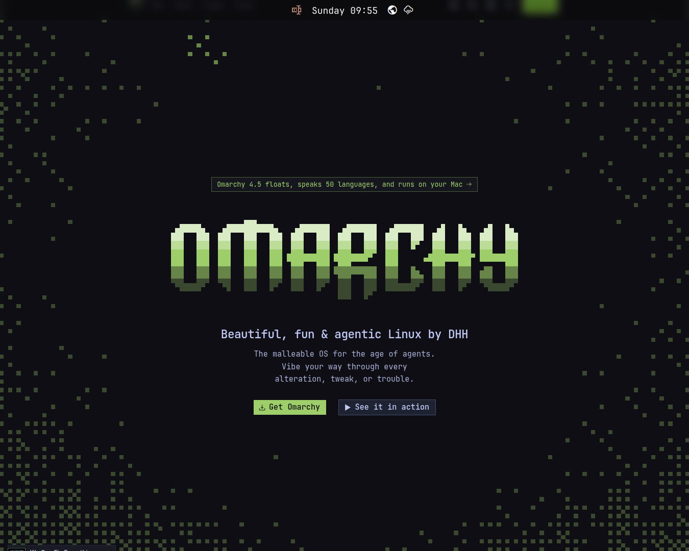

# Public Wi-Fi captive-portal reproduction

Supporting evidence for https://github.com/omacom/omarchy/pull/17052, recorded on 2026-11-08 with Omarchy 4.5.0-3 and Chromium 155.0.8059.84 (Arch Linux).

On a real public Wi-Fi network, the network panel showed “Sign into network”, but clicking it opened the Omarchy homepage in the floating sign-in window instead of the venue login page.

## Observations

- A detached local watcher kept recording across the loss of internet access. While NetworkManager reported `portal`, HTTP requests to `http://ping.omacom.io/nm-check.txt` returned `307 Temporary Redirect` to an HTTPS splash page at `apac.network-auth.com`.
- During the same attempt, the Chromium sign-in window's title was “Omarchy - Beautiful, fun & agentic Linux by DHH”. Browser history recorded HTTP probe URL → HTTPS probe URL → `https://omarchy.org/`.
- A separate fresh-profile browser test reproduced an initial network request to the HTTPS probe despite supplying the HTTP URL. The HTTPS probe answered the browser with a 302 to the Omarchy homepage. A direct request with `Accept: text/html` also reproduced this homepage redirect.
- Repeating the fresh-profile browser test with `--disable-features=HttpsUpgrades` preserved the initial HTTP request. The installed workaround's launcher was also checked with a browser network log and preserved HTTP.

## Real-network workaround result

The local workaround launches the existing Omarchy portal handler with an isolated browser profile under `$XDG_RUNTIME_DIR`, passing `--disable-features=HttpsUpgrades`, `--no-first-run`, and `--no-default-browser-check`. The normal browser configuration is unchanged. A user-owned network plugin invokes this wrapper; the Omarchy shell had to be restarted for the live button to use it.

The user repeated the sign-in on the public network and confirmed that it worked. The watcher recorded these UTC transitions:

| Time | NetworkManager | Sign-in window / HTTP probe |
| --- | --- | --- |
| 02:08:02 | portal | HTTP 307 to the network's HTTPS splash page |
| 02:08:08 | portal | Window title changed to the venue login page; HTTP probe still returned 307 |
| 02:08:15 | full | HTTP 204 with `X-NetworkManager-Status: online`; sign-in window closed |

This is a real-network confirmation of the failure mode and of the isolated-profile workaround. **The PR's exact `HttpAllowlist` policy and migration have not been tested on this network.** The screenshot is the failing state; it is not a capture of the successful login.

Raw logs, venue identifiers, redirect query strings, and the network-panel screenshot containing local addressing are intentionally omitted.
